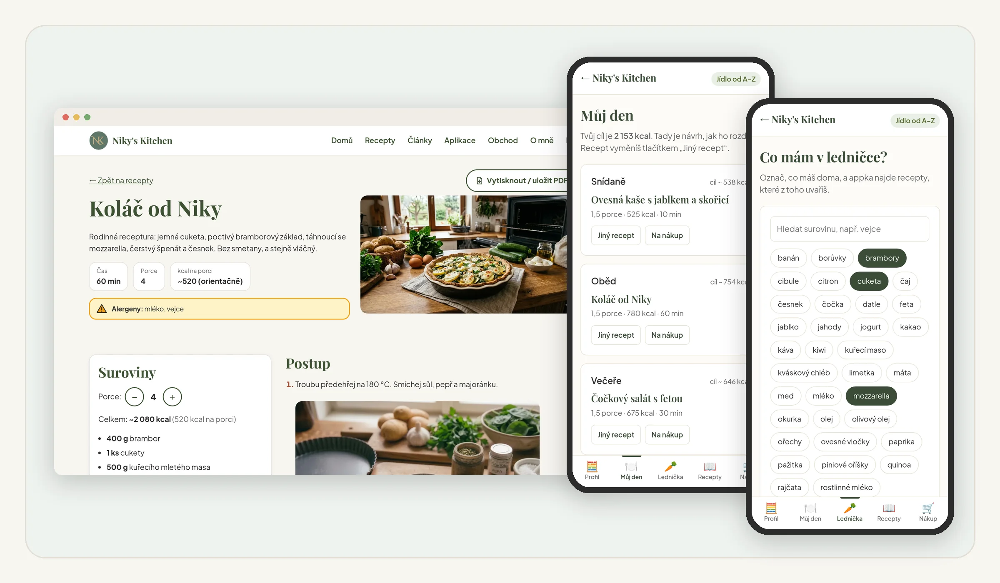
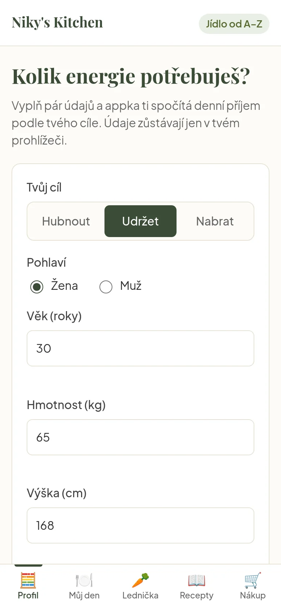
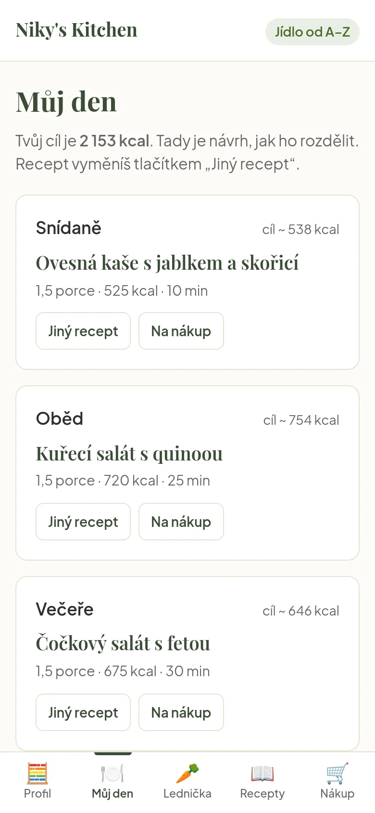
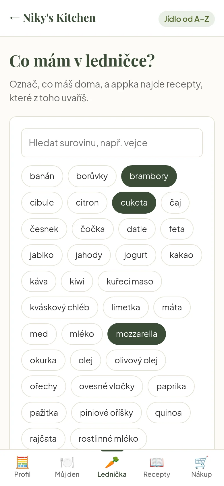
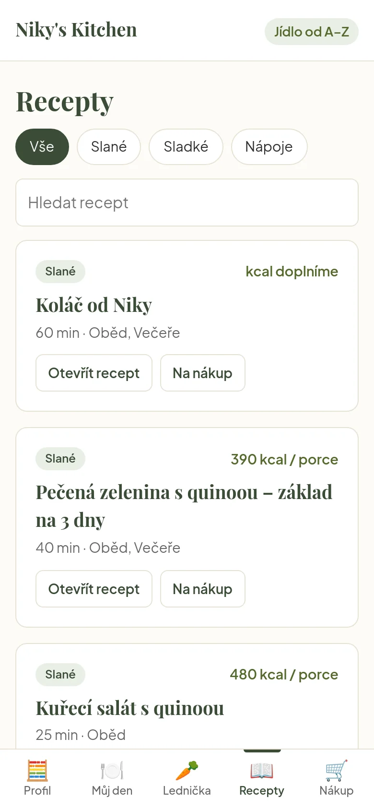
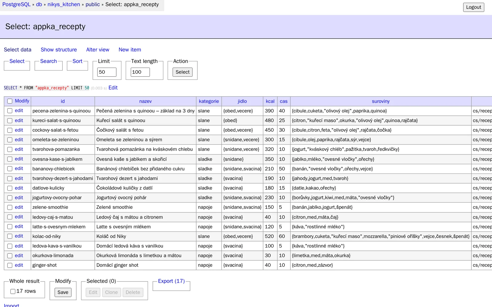

# Jídlo od A–Z

Webová appka značky **Niky's Kitchen**: spočítá, kolik toho denně sníst, rozdělí to do jídel, najde recepty podle toho, co máš v ledničce, a sestaví nákupní seznam. Česky, brzy i anglicky.

**Živá appka:** https://4613nikola-oss.github.io/jidlo-od-a-z/
**Web Niky's Kitchen:** https://4613nikola-oss.github.io/nikys-kitchen-web/
**Docker obraz:** [nikolapaluskova/jidlo-od-a-z](https://hub.docker.com/r/nikolapaluskova/jidlo-od-a-z)



## Jaký problém to řeší

Hodně lidí chce jíst zdravě, ale v praxi narazí na tohle:

- **Neví, kolik toho sníst.** Kalkulačka jim dá číslo v kcal, ale už neřekne, co si z toho dát k obědu.
- **Nemají čas.** Po práci nebo tréninku nechtějí složité recepty ani extra nákup.
- **Zapisování jídel je otravné.** Počítat a zapisovat každé sousto zabere čas a často vede k výčitkám, proto s tím hodně lidí brzy skončí.
- **Rady jsou roztroušené** po webech, appkách a sociálních sítích a často si odporují.

**Na co to je:** dát jednu jasnou odpověď na otázku *„co mám dnes jíst a kolik“*, a to bez zapisování a bez výčitek.

**Pro koho:** ženy i muži 18+, kteří berou zdravé jídlo jako investici do budoucna, ale nemají moc času. Chtějí zhubnout, udržet formu nebo nabrat svaly, často sportují nebo pracují na nohou.

**Čím je to jiné:**
- žádné zapisování jídel ani denní počítání, stačí jednou zadat profil,
- jeden základ receptu a tři varianty (zhubnout / udržet / nabrat), takže se pro celou rodinu vaří jednou,
- vaří se z toho, co je doma v ledničce, a nákupní seznam se sestaví sám,
- v plánu je i „sladká tečka“, protože zdravé jídlo nemá být trest,
- krátké texty s možností rozkliknout víc, čeština a angličtina, důraz na přístupnost (i pro lidi se zrakovým postižením),
- informace jen z ověřených zdrojů, bez zdravotních slibů.

## Proč si appku otevřít (a přidat na plochu)

- **Za pár minut víš, kolik toho denně sníst.** Stačí věk, výška, váha, pohyb a cíl, nic dalšího nezapisuješ.
- **Neřeší jen čísla, ale konkrétní jídla.** Rozdělí příjem na snídani, oběd, večeři a svačinu a k nim navrhne recepty a porce.
- **Uvaříš z toho, co máš doma.** Zadáš, co je v ledničce, a appka ukáže, co z toho jde uvařit a co dokoupit.
- **Nákupní seznam se sestaví sám** a vezmeš si ho do obchodu v mobilu.
- **Zdarma, bez registrace a bez reklam.** Údaje zůstávají jen v tvém prohlížeči, nikam se neposílají.
- **Funguje jako appka v mobilu.** Přes „Přidat na plochu“ ji máš po ruce bez stahování z obchodu s aplikacemi.

## Niky's Kitchen – jak to spolu souvisí

Niky's Kitchen má tři části. Cíl je pořád stejný: ulehčit lidem zdravé stravování bez složitého počítání a bez výčitek.

| Část | Co to je | Stav |
|------|----------|------|
| 🌐 **Web s blogem** | recepty (slané, sladké, nápoje) a krátké články o výživě, česky i anglicky | online: https://4613nikola-oss.github.io/nikys-kitchen-web/ |
| 📱 **Appka Jídlo od A–Z** (tento projekt) | kalkulačka příjmu, plán jídel, recepty z ledničky, nákupní seznam | online, zdarma |
| 🛒 **Obchod** | digitální produkty: e-booky, online kuchařka, jídelní plány, kurzy | připravujeme |

**Jak na sebe navazují:** na webu najdeš recept nebo článek → v appce si spočítáš, co a kolik jíst, a uvaříš z toho, co máš doma → kdo chce víc, koupí si v obchodě hotový plán nebo e-book.

Appka bude časem přímo součástí webu. Už teď si bere recepty a články ze stejné databáze jako web (viz níže).

## Co appka umí

- **Profil** – z věku, váhy, výšky, pohybu a cíle (zhubnout / udržet / nabrat) spočítá denní příjem v kcal (rovnice Mifflin-St Jeor, jen pro dospělé 18+, nikdy pod bazální metabolismus).
- **Můj den** – rozdělí příjem na snídani, oběd, večeři a svačinu, navrhne recepty a počet porcí.
- **Lednička** – podle surovin doma ukáže, co jde uvařit a co chybí.
- **Recepty** – slané, sladké a nápoje, s hledáním.
- **Nákup** – nákupní seznam z receptů, celého dne nebo ledničky.
- Doporučí články z blogu podle cíle, pamatuje si údaje jen v tvém prohlížeči (localStorage, nic se neposílá na server) a jde přidat na plochu mobilu.

> Appka nenahrazuje lékařskou ani nutriční radu.

## Ukázky

| Profil | Můj den | Lednička | Recepty |
|---|---|---|---|
|  |  |  |  |
## Odkud se berou recepty

Recepty a články jsou uložené v **databázi PostgreSQL** projektu Niky's Kitchen (repozitář `nikys-kitchen-web`). Web z nich při sestavení vyrobí soubor `api/appka.json` a appka si ho při startu stáhne.

- Appka se ukáže hned se záložními recepty z `js/data.js`. Jakmile dorazí recepty z databáze, překreslí se.
- Když se stažení nepovede (bez internetu, web neběží), zůstanou záložní recepty, takže appka funguje vždycky.
- Recepty bez kcal (Niky je ještě doplní) se v Receptech a Ledničce ukážou, ale do plánu dne se nedávají, protože se k nim nedá spočítat porce.
- Na počítači (`localhost`) appka čte recepty z webu na http://localhost:3000, jinak z https://4613nikola-oss.github.io/nikys-kitchen-web/.



## Technologie

HTML, CSS, čistý JavaScript (bez frameworků), `fetch` + JSON z databáze PostgreSQL, localStorage, PWA manifest, Docker + nginx.

## Struktura

```
index.html      stránka aplikace
manifest.json   nastavení pro přidání na plochu
ikona.svg       ikona
css/app.css     vzhled
js/app.js       logika aplikace (+ načtení receptů z databáze přes web)
js/data.js      záložní recepty a články, když se databáze nenačte
docs/ukazky/    screenshoty do README
```

## Spuštění

```
docker compose up -d --build
```

Appka poběží na http://localhost:8080. Aby brala recepty z databáze, spusť vedle i web (`docker compose up -d` ve složce webu). Změny v HTML, CSS a JS se projeví po obnovení stránky. Zastavení: `docker compose down`.

## Větve

- `dev` – rozpracované změny
- `main` – živá appka (GitHub Pages se aktualizuje do minuty)

## Plán

- skutečné kcal u všech receptů (doplňují se v databázi)
- anglická verze
- týdenní jídelníček se „sladkou tečkou“
- appka jako součást nového webu
